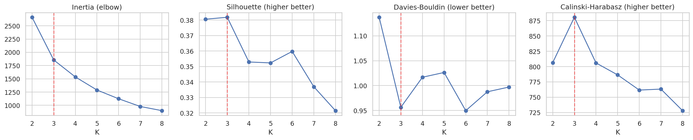
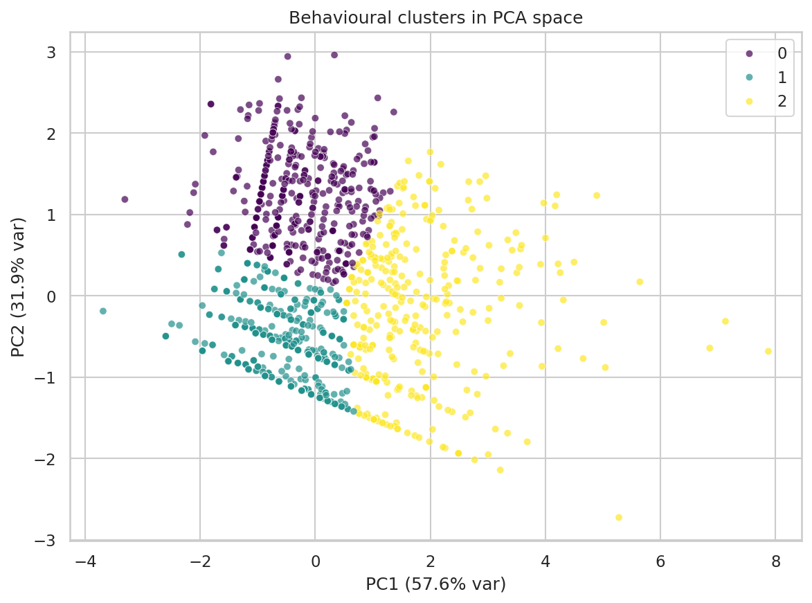
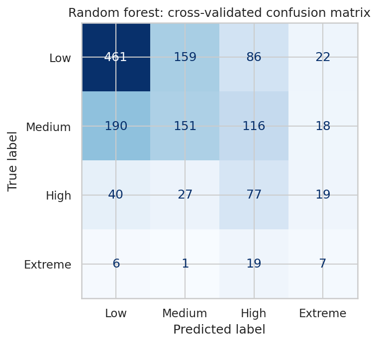
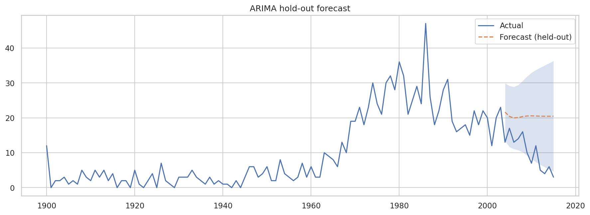

# Serial Killer Typology Discovery

Unsupervised discovery of offender typologies in ~1,500 documented serial killers, combined with association
rule mining, a victim-severity classifier and ARIMA trend analysis. Course project (CSE437, BRAC University).

**Main finding:** clustering on behavioural features (victim counts and active duration) gives three stable groups
that are independent of era, but the evidence points to a *continuum* rather than sharply separated types.

## Results

Final run: 1,531 raw rows, 119 duplicate records removed, **N = 1,399** modelled.

| Metric | Value |
|---|---|
| Chosen K / silhouette | 3 / 0.382 |
| Bootstrap stability (mean ARI, 50 resamples) | 0.96 |
| Cluster vs decade (adjusted mutual information) | 0.02 (clusters are not time periods) |
| Agreement with K-Means (ARI) | Ward 0.79, Gaussian mixture 0.06, DBSCAN: 1 group + 106 noise points |
| Severity model, 5-fold CV macro-F1 | 0.37 (majority baseline 0.17; model with leaky feature 0.71) |
| ARIMA(2,1,2) hold-out RMSE (2004-2015) | 11.5 (last-value forecast 13.8, 5-year mean 10.5) |
| Offenders starting per year | 3.7 before 1970, 20.2 in 1970-2015 |

### The three clusters

| | Prolonged | Short-run | High-toll |
|---|---|---|---|
| Share (n) | 28% (390) | 49% (680) | 24% (329) |
| Median proven / possible victims | 4 / 6 | 4 / 5 | 17 / 28 |
| Median active duration | 13 years | 2 years | 6 years |
| Median start year | 1975 | 1985 | 1980 |
| North America share | 77% | 81% | 38% |

- **Short-run:** one to five years of activity and a few victims; over-represented in the 2000s-2010s, partly because recent cases have had less time to build a documented span (right-censoring).
- **Prolonged:** similar victim counts but long careers (5+ years, median 13), concentrated in the 1970s-1980s.
- **High-toll:** far more victims (at least 11 possible each) and the most geographically diverse group (14% Eastern Europe/Russia, 14% Western Europe, 10% Latin America, 10% Asia, 7% Africa).

The partition is largely a split on duration and possible-victim count. A Gaussian mixture disagrees strongly with
K-Means, and K = 2 scores almost the same silhouette as K = 3, so the clusters summarise a continuum rather than
natural categories.

### Other findings
- **Severity prediction is hard once victim counts are excluded.** Duration, decade and North American origin are the strongest predictors (macro-F1 0.37 vs 0.17 baseline). Adding possible-victim counts jumps accuracy to 79%, which shows how strongly that feature leaks the target.
- **Association rules are weak** (max lift 2.8). The strongest links offenders starting in the 2010s+ with a one-year documented span, consistent with right-censoring; most other rules reflect the dataset's concentration in North America and 1970-1989.
- **ARIMA is descriptive only.** It beats a last-value forecast but not a 5-year average, and it kept forecasting about 20 per year while documented counts fell to about 5.

| | |
|---|---|
|  |  |
|  |  |

## Methodology

1. **Cleaning:** parse `Years active` (ranges, `1990s`, citation markers), reduce victim ranges and "N+" to lower bounds, treat "numerous" as missing, cap durations at 60 years.
2. **De-duplication:** the source merges lists that name the same person in different formats (e.g. "Aileen Wuornos" / "Wuornos, Aileen"). Rows with the same normalised name and start year are collapsed (119 removed).
3. **Features:** log-transformed, standardised proven victims, possible victims and active duration. Era and region are *not* clustering inputs; they are used afterwards to describe clusters.
4. **Clustering:** K chosen with silhouette, Davies-Bouldin and Calinski-Harabasz over K = 2-8; K-Means compared with Gaussian mixture, Ward agglomerative and DBSCAN; stability via bootstrap resampling.
5. **Text features:** keyword themes and TF-IDF clusters from the `Notes` column.
6. **Severity classifier:** victim counts excluded; stratified 5-fold CV with macro-F1 against a majority baseline; a deliberately leaky model shown for contrast.
7. **Association rules:** Apriori on discretised features, filtering out trivial rules within the same feature family.
8. **Time series:** yearly counts of offenders by start year (no imputation), ARIMA order chosen by AIC, evaluated on a held-out final window against naive baselines.

## Repository structure
```
notebooks/Serial_Killer_Typology_Clustering_v2.ipynb   # the full analysis
data/                                                  # place serial_killers.csv here (optional)
figures/                                               # plots generated by the notebook
results/                                               # result tables and summary.json
requirements.txt
```

## Run it
```bash
python -m venv .venv && source .venv/bin/activate      # Windows: .venv\Scripts\activate
pip install -r requirements.txt
jupyter notebook notebooks/Serial_Killer_Typology_Clustering_v2.ipynb
```
Then choose **Kernel > Restart & Run All**. It also runs in Google Colab (upload the notebook and run all).

- The notebook loads `data/serial_killers.csv` if present; otherwise it downloads the dataset with `kagglehub` (may need Kaggle credentials).
- Everything is seeded (`SEED = 42`).
- Running it regenerates `figures/` and `results/`, including `results/model_sample_with_clusters.csv` (one row per offender, git-ignored).

## Limitations
- The data is Wikipedia-derived, heavily US-skewed and biased toward convicted or well-documented offenders; results do not generalise to all serial homicide.
- Victim counts are noisy (ranges and "N+" collapsed to lower bounds; some counts filled from the other column).
- Remaining duplicates are possible where name variants differ beyond word order.
- Recent cases may be uncaught or undocumented (right-censoring), so apparent recent declines are unreliable.
- Cluster-difference p-values (Kruskal-Wallis in the notebook) are descriptive only, because the clusters are built from the same variables.
- Notes themes come from keyword matching, not manual coding.

## Data source
A. Samiir, "Serial Killers Wiki," Kaggle, 2021. https://www.kaggle.com/datasets/abdullahsamiir/serial-killers-wiki

The raw CSV is not included in this repository; check the dataset's license before redistributing it. This project is
an academic analysis of publicly documented historical records and is not intended for offender profiling or
real-world decision making.
